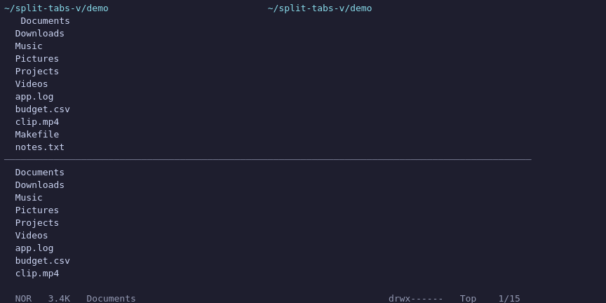

# split-tabs-vertical.yazi

<p align="center">
    
</p>

A [Yazi](https://github.com/sxyazi/yazi) plugin that provides a dual-pane view by
splitting the screen between two tabs — **side-by-side or stacked top/bottom**.

This is a fork of [terrakok/split-tabs.yazi](https://github.com/terrakok/split-tabs.yazi)
(MIT, © 2026 Konstantin Tskhovrebov). It keeps upstream's dual-pane core and adds
a switchable orientation, pane resizing, and a set of bug fixes that upstream
does not have yet (see [Changes vs. upstream](#changes-vs-upstream)).

## Features
- Toggle dual-pane mode
- Switch focus between panes
- Toggle a full-width preview panel at the bottom
- **Flip orientation**: side-by-side ↔ top-bottom (`spl_flip`)
- **Resize panes**: `spl_resize ±n`, clamped to 10–90%
- Copy or move the selection straight into the other pane (`spl_copy`, `spl_move`)

## Requirements
- **Yazi 26.8.15 or newer.** The plugin subscribes to the `ind-watch` and
  `relay-update-files` DDS events, which Yazi only publishes from 26.8.15 on.
  The `--- @since 26.8.15` annotation makes Yazi refuse to load the plugin on
  older versions instead of failing silently (panes that render but never
  refresh).
- No external binaries. Lua only.

## Installation

```sh
ya pkg add Geronfir/split-tabs-vertical
```

or manually:

```sh
# Windows
git clone https://github.com/Geronfir/split-tabs-vertical.yazi %AppData%\yazi\config\plugins\split-tabs-vertical.yazi
# Linux/macOS
git clone https://github.com/Geronfir/split-tabs-vertical.yazi ~/.config/yazi/plugins/split-tabs-vertical.yazi
```

## Configuration
Add this to your `keymap.toml`:

```toml
[mgr]
prepend_keymap = [
    { on = "\\", run = "plugin split-tabs-vertical spl_toggle", desc = "Split-tabs: toggle split tabs mode" },
    { on = "<Tab>", run = "plugin split-tabs-vertical spl_switch_tab", desc = "Split-tabs: switch to the other pane" },
    { on = "<F5>", run = [ "escape --visual", "plugin split-tabs-vertical spl_copy" ], desc = "Split-tabs: copy to the other pane" },
    { on = "<F6>", run = [ "escape --visual", "plugin split-tabs-vertical spl_move" ], desc = "Split-tabs: move to the other pane" },
    { on = "b", run = "plugin split-tabs-vertical spl_preview", desc = "Split-tabs: toggle preview pane" },
    { on = "F", run = "plugin split-tabs-vertical spl_flip", desc = "Split-tabs: flip side-by-side/top-bottom" },
    { on = "<C-Left>", run = "plugin split-tabs-vertical spl_resize -5", desc = "Split-tabs: shrink active pane" },
    { on = "<C-Right>", run = "plugin split-tabs-vertical spl_resize 5", desc = "Split-tabs: grow active pane" },
    ...
]
```

### Actions

| Action | Arguments | Description |
| --- | --- | --- |
| `spl_toggle` | – | Toggle dual-pane mode on/off. |
| `spl_activate` | – | Enter dual-pane mode (idempotent). |
| `spl_deactivate` | – | Leave dual-pane mode and close the second tab. |
| `spl_switch_tab` | – | Move focus to the other pane. |
| `spl_flip` | – | Flip between side-by-side and stacked layouts. |
| `spl_resize` | `±n` (default `5`) | Grow/shrink the focused pane by `n` percent; clamped to 10–90. |
| `spl_preview` | – | Toggle the full-width preview panel at the bottom. |
| `spl_copy` | – | Copy the selection (or hovered file) to the other pane. |
| `spl_move` | – | Move the selection (or hovered file) to the other pane. |

### Activate on startup

The plugin also exposes the idempotent `spl_activate` action. Add this to
`~/.config/yazi/init.lua` (create the file if it does not exist):

```lua
ya.emit("plugin", { "split-tabs-vertical", "spl_activate" })
```

## Keybinding notes
Yazi's default `[mgr]` keymap already binds `<Tab>` (spot) and `P` (paste). This
plugin's bindings are `prepend`ed, so they take priority for the file manager;
remap them in `keymap.toml` if you rely on the originals. `F`, `b`, `<F5>` and
`<F6>` are free in the default `[mgr]` keymap.

## Changes vs. upstream

Bug fixes (all still present in upstream `main` at the time of writing):

- **Fix: negative `ui.truncate` width on narrow terminals.** `ui.truncate`'s
  `max` is an unsigned integer in Yazi; the old expression
  `math.max(0, w - mid - 1 - right_width) - 4` could go negative and raise an
  out-of-range error. All widths are now clamped to `>= 0`.
- **Fix: `Rect` height underflow in top-bottom mode.** The bottom pane's marker
  rect used `h = c[2].h - 1`, which is `-1` when the pane is 0 rows tall and
  overflows the `u16` height. Clamped with `math.max(0, ...)`.
- **Fix: header misalignment for non-ASCII paths.** The left path was padded
  using `#p1` (bytes) instead of display columns, so CJK/emoji/accents drifted
  out of alignment. Now measured with `ui.width` when available.
- **Fix: wrong separator glyph in top-bottom mode.** The separator Bar was
  given `th.mgr.border_symbol` (`│`, vertical), so a horizontal row was painted
  with vertical glyphs. It now lets `ui.Bar` pick `─` for a TOP edge.
- **Fix: `@since` was too low.** Bumped to `26.8.15` to match the DDS events the
  plugin actually subscribes to.

New features:

- `spl_flip` — switch between side-by-side and top-bottom layouts.
- `spl_resize ±n` — resize the focused pane, clamped to 10–90%.

## Portability

The plugin is pure Lua and only touches terminal-independent APIs, so the same
file is used on every platform Yazi supports. It has been exercised on Android
arm64 (Termux) with Yazi 26.9.1; the notes below describe the reasoning for
other targets.

| Area | Risk | Handling |
| --- | --- | --- |
| Paths / separators | None | The plugin never builds or parses OS paths; it only reads `cwd`, `file.url` and `url.name`, all produced by Yazi. |
| Non-ASCII paths | Alignment drift | Column widths are measured with `ui.width` (display columns) instead of `#s` (bytes). |
| Narrow terminals | Hard error | All widths are clamped to `>= 0` before reaching `ui.truncate`. |
| Very short panes | Rect underflow | Rect heights/origins are clamped with `math.max(0, ...)`. |
| Key bindings | Terminal dependent | `<C-Left>`/`<C-Right>` and function keys depend on the terminal emitting distinct sequences; remap if yours swallows them. |
| Windows | Unverified | No POSIX-only API is used, but the plugin has not been run on Windows. |
| macOS / Linux x86_64 | Unverified | Same Lua surface; no platform-specific code paths. Expected to work, not tested here. |
| Image protocols | Out of scope | The preview panel delegates to Yazi's own `Preview` component. |

## Known limitations
- The second tab is closed on deactivate; navigation done in the right pane while
  split is discarded.
- `spl_resize` clamps to 10–90%, so a pane can never be fully collapsed.
- The plugin swaps `Tab.layout`, `Tab.build`, `Header.cwd`, `Tabs.height` and
  `Entity.style` while active, and restores them on deactivate. Other plugins
  that patch the same components may conflict.

## Credits & License
MIT. Based on [terrakok/split-tabs.yazi](https://github.com/terrakok/split-tabs.yazi),
© 2026 Konstantin Tskhovrebov. See `LICENSE` for the full text.

## Support the upstream developer

<p align="center">
  <a href="https://www.buymeacoffee.com/terrakok" target="_blank"></a>
</p>

If you enjoy the project and want to support its development, consider buying
the upstream author a coffee. Your support helps keep this project free and
open-source!
